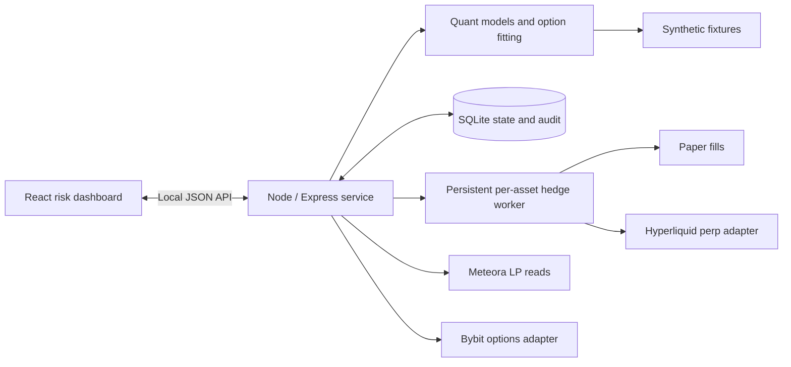
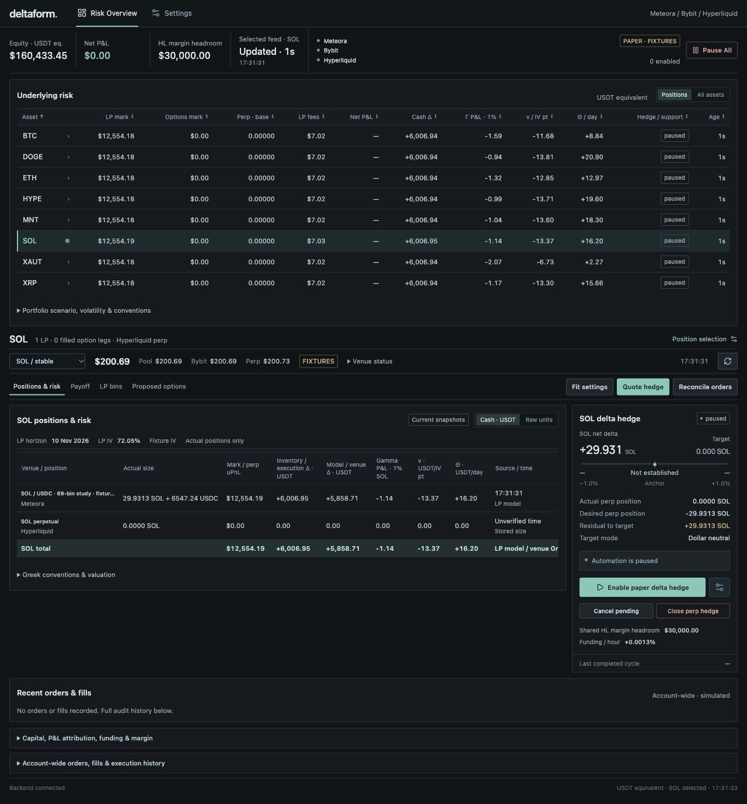
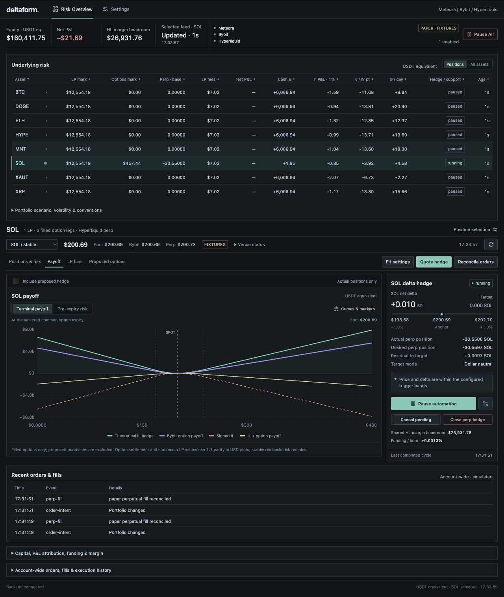

# Deltaform

**A research workbench for hedging concentrated liquidity with options and perpetuals.**

Deltaform connects **Meteora DLMM liquidity positions**, **Bybit options**, and **Hyperliquid perpetual hedges** in a local, multi-asset application. I built it to take a liquidity-provider hedge from its mathematical payoff to a constrained options proposal, a paper execution, and a combined view of portfolio risk.

The research question is whether **LP fee income can justify the cost of reducing impermanent loss and directional exposure**. Option premiums, trading fees, perpetual funding, slippage, basis, and residual risk all affect the answer. The project implements and demonstrates the hedge workflow; profitability remains an open question.

**Current status:** runnable synthetic paper demo, tested quantitative and execution logic, and implemented venue adapters. Historical development notes record public market reads and authenticated read-only account discovery. This showcase does not establish successful live trades or production readiness.

## What I built

| Work | What the implementation does | Evidence |
| --- | --- | --- |
| DLMM payoff decomposition | Expresses the ideal fee-free terminal shortfall versus a fixed HODL benchmark as weighted calls and puts | [Math](docs/MATH.md), [implementation](src/quant/math.ts), [tests](tests/quant.math.test.ts) |
| Executable options fitting | Fits incremental long-option purchases to available strikes, common expiry, depth, lots, budget, and leg limits; reports residual error | [Fitter](src/quant/fit.ts), [tests](tests/quant.fit.test.ts) |
| Current gamma targeting | Targets combined current LP model gamma and filled-option venue gamma within a configured tolerance | [Gamma search](src/quant/gamma.ts), [tests](tests/gamma-fit.test.ts) |
| Persistent delta hedging | Runs per-asset perpetual hedge cycles with price anchors, exposure limits, shared margin controls, and durable order intentions | [Engine](server/engine.ts), [multi-asset tests](tests/multi-asset-engine.test.ts) |
| Portfolio risk interface | Shows actual positions, cash/raw Greeks, terminal and pre-expiry scenarios, capital, and account P&L in two tabs | [Client](src/client/App.tsx), [risk calculations](src/client/portfolio-risk.ts) |
| Accounting and recovery | Tracks opening capital and manually recorded external flows; reconciles partial or unknown order outcomes without assuming fills | [Capital tracking](server/capital-tracking.ts), [options service](server/bybit-options.ts), [recovery](server/hedge-recovery.ts) |
| Paper execution and adapters | Provides eight synthetic asset books, venue normalization, and tests with mocked account/order responses | [Fixtures](src/quant/fixtures.ts), [adapters](src/venues), [validation](docs/VALIDATION.md) |

## How the strategy works

1. **Measure the liquidity position.** Read each bin's economic inventory and preserve its reference HODL allocation. Accrued LP fees belong to the account mark and remain separate from fee-free IL.
2. **Choose the options objective.** Approximate terminal IL protection, seek conservative terminal coverage, or target current gamma. Review the proposed quantities, cost, expiry, and remaining risk before an explicit purchase.
3. **Manage directional exposure.** After enabling the worker, hedge actual LP inventory and filled-option delta with the matching perpetual. Price moves, portfolio changes, and large delta deviations can trigger reconciliation.
4. **Inspect the combined book.** Keep executed positions distinct from proposals; compare Greeks, payoff scenarios, capital, and execution history.

These are three different hedge objectives:

| Objective | Target | Main limitation |
| --- | --- | --- |
| Terminal IL protection | The fee-free LP shortfall versus the fixed HODL benchmark at a chosen expiry | Real strikes, lots, premiums, and available depth make the executable basket approximate |
| Current gamma targeting | Current LP model gamma plus filled-option venue gamma | Local, model-dependent sensitivity; changes with price, IV, and time |
| Delta hedging | Actual current inventory plus filled options and the perpetual, relative to dollar-neutral or HODL exposure | Rebalancing is discrete and constrained by freshness, basis, margin, and execution limits |

For one frozen bin at price $p$, with original amounts $x$ base and $y$ quote, its fee-free terminal shortfall is a weighted call and put payoff:

$$
H(S_T)=x(S_T-p)^++\frac{y}{p}(p-S_T)^+,\qquad (z)^+=\max(z,0).
$$

Long options offset the LP model's negative gamma; the perpetual separately adjusts actual inventory and filled-option delta. Vega and theta residuals are monitored without independent targets. Exact terminal replication restores the original HODL payoff before costs, which still has directional exposure. Read the [short math note: option hedge and Greeks](docs/MATH_NOTE.md), [strategy mechanics](docs/STRATEGY.md), or [full derivation](docs/MATH.md).

## Architecture



The public demo uses the real paper engine in an isolated harness: a temporary database, synthetic markets, disconnected accounts, and live mode disabled. The full local service contains the venue adapters. Options purchases remain explicit; the background worker automates only perpetual delta hedging. State and order intentions survive restarts in the full service.

**Stack:** TypeScript, React, Vite, Recharts, Node, Express, SQLite, Decimal.js, and Vitest. Read the [architecture and module guide](docs/ARCHITECTURE.md).

## Screenshots — synthetic paper data

All prices, balances, option instruments, positions, and fills below are synthetic. These screenshots show application behavior, not investment performance or live account activity.

### Multi-asset risk overview



The eight-asset fixture catalog covers BTC, ETH, SOL, XAUT, HYPE, XRP, MNT, and DOGE. **Eight demo assets do not imply eight fully supported live strategies.** Live support requires verified token identity, listed options, a matching perpetual, acceptable basis, and account compatibility.

### Payoff workspace after paper execution



Terminal and pre-expiry plots answer different questions. The pre-expiry view holds the current perpetual size fixed; it does not forecast future automatic hedge paths. See the [paper walkthrough and options review screenshot](docs/DEMO.md).

## Run the showcase

Use Node **22.13+** or **24 LTS**, with npm.

```sh
npm ci
npm run build
npm run demo:showcase
```

Open **http://127.0.0.1:8788/**. The demo needs no `.env`, wallet, or API key. It starts with eight synthetic asset books and creates a fresh temporary paper database on every launch. Stop it with Ctrl-C. Use `UI_QA_PORT` to choose another unused port; port 8787 is reserved for the full local service.

Follow the [five-minute demo](docs/DEMO.md). The [local runbook](docs/RUNBOOK.md) describes the persistent application separately.

## Validation and maturity

On **11 October 2026 (Europe/Moscow)**, the current checkout passed:

- **658 tests across 42 files** (`npm test`).
- TypeScript checking (`npm run typecheck`).
- Production build (`npm run build`).

Tests cover payoff identities, model sensitivities, constrained fitting, accounting, venue response normalization, partial/unknown outcomes, restart recovery, and shared margin controls. Authenticated order tests use fixtures and mocks. Test results establish behavior under those inputs; they do not certify exchange acceptance or profitability.

The isolated browser walkthrough and exact validation scope are recorded in [VALIDATION.md](docs/VALIDATION.md). The build retains an existing bundle-size advisory; the existing Node 23 verification runtime emits an experimental SQLite warning. The refreshed [dependency audit](docs/DEPENDENCIES.md) records five high and two critical affected package entries; dependencies were not changed for this showcase.

## Limits and research questions

- Scenarios are illustrative model calculations, not a historical backtest, realized equity curve, or return forecast. LP fees, funding, latency, and basis assumptions need empirical validation.
- Sparse strikes, option depth, minimum lots, and budgets can leave residual exposure. The fitter is a constrained heuristic and does not prove global optimality.
- Cross-venue positions and option baskets are non-atomic. Partial fills, stale data, collateral shortages, and unknown responses require reconciliation.
- Stablecoin parity is approximate; wrapped-token, index, settlement, and cross-venue basis remain.
- Account P&L uses an opening snapshot plus manually recorded external flows. Per-asset P&L allocation and a complete historical equity series remain unavailable.
- The application does not automatically buy or roll options, recenter liquidity, or transfer collateral. It targets single-user local operation.
- Historical read-only venue observations are separate from actual order/fill validation. No live order was submitted to prepare this showcase.

The next research steps are better cost and fee evidence, a defensible equity series, and measured hedge behavior across price and volatility paths. See the [focused roadmap](docs/ROADMAP.md).

## Repository guide

- [Strategy](docs/STRATEGY.md) · [Short math note](docs/MATH_NOTE.md) · [Full math](docs/MATH.md) · [Scenario assumptions](docs/SIMULATION.md)
- [Architecture](docs/ARCHITECTURE.md) · [Demo](docs/DEMO.md) · [Local runbook](docs/RUNBOOK.md)
- [Validation](docs/VALIDATION.md) · [Roadmap](docs/ROADMAP.md) · [Public packaging](docs/PUBLICATION.md)

This repository is a portfolio and research showcase. Its contribution is the implemented bridge between DLMM payoff analysis, constrained hedge construction, paper execution, and transparent portfolio risk.
