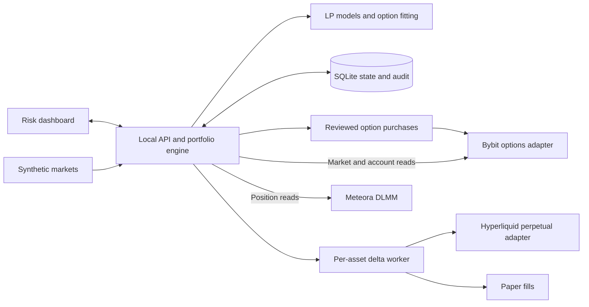

# Deltaform

**DLMM liquidity risk, option fitting, and perpetual hedging.**

## Overview

A **liquidity provider (LP)** supplies tokens for swaps and earns trading fees, but swaps change the tokens held as prices move. The position can fall behind simply holding the original tokens: this shortfall is **impermanent loss (IL)**. Meteora's **DLMM** divides liquidity into fixed-price bins, making that inventory and payoff measurable at each price level.

Deltaform connects that payoff analysis to **Bybit option proposals**, **Hyperliquid perpetual delta hedges**, and a **multi-asset risk dashboard**. Options provide paid, expiry-specific protection; perpetual hedges adjust directional exposure and pay or receive funding. The research question is whether LP fees justify premiums, funding, fees, slippage, collateral requirements, basis and remaining risk.

**Status:** a runnable synthetic paper demo with implemented quantitative models, venue adapters, persistent hedging and recovery logic. The recorded **11 October 2026** verification passed **658 tests across 42 files**, type checking and the production build. Profitable live performance and production execution remain open questions.

[Strategy](docs/STRATEGY.md) · [Mathematics](docs/MATH_NOTE.md) · [Architecture](docs/ARCHITECTURE.md) · [Paper demo](docs/DEMO.md)

## Implementation

| Component | Behavior | Evidence |
| --- | --- | --- |
| LP payoff model | Represents the fixed-bin terminal shortfall as weighted call and put payoffs | [Math and assumptions](docs/MATH_NOTE.md), [payoff code](src/quant/math.ts), [independent payoff tests](tests/quant.math.test.ts) |
| Option fitting | Fits listed options under strike, expiry, depth, lot, budget and leg constraints; reports residual and tail errors | [Fitter](src/quant/fit.ts), [fitting tests](tests/quant.fit.test.ts) |
| Current gamma targeting | Computes a gamma objective from LP model risk and signed filled-option Greeks | [Gamma search](src/quant/gamma.ts), [gamma tests](tests/gamma-fit.test.ts) |
| Perpetual hedge worker | Runs per-asset cycles with price anchors, exposure limits, shared margin reservations and durable order intentions | [Engine](server/engine.ts), [policy](server/policy.ts), [multi-asset tests](tests/multi-asset-engine.test.ts) |
| Risk and accounting | Displays raw/cash Greeks, payoff scenarios, capital, recorded flows, account P&L and execution state | [Dashboard](src/client/App.tsx), [risk calculations](src/client/portfolio-risk.ts), [capital accounting](server/capital-tracking.ts) |
| Venue and paper execution | Provides paper fills, venue response normalization, partial/unknown order reconciliation and restart recovery | [Adapters](src/venues), [options service](server/bybit-options.ts), [recovery](server/hedge-recovery.ts), [validation](docs/VALIDATION.md) |

## Strategy

1. **Terminal IL protection:** approximate the frozen LP position's shortfall against holding its original tokens at a chosen option expiry.
2. **Current gamma targeting:** offset the current LP model's curvature—how its price sensitivity changes—as measured at quote time.
3. **Delta hedging:** adjust actual LP inventory and filled-option price sensitivity with the perpetual, targeting either zero directional exposure or the original holding exposure.

Exact terminal protection restores the original **HODL** payoff (holding the original tokens) before costs. That payoff still has directional exposure. A current gamma fit answers a different question and can leave terminal, volatility and time-decay risk. Perpetual rebalancing is discrete and constrained by prices, freshness, basis, margin and execution limits.

<details>
<summary><strong>Short mathematical explanation and Greeks</strong></summary>

For a frozen bin at price $p$, with original amounts $x$ base and $y$ quote, the fee-free terminal shortfall is

$$
H(S_T)=x(S_T-p)^++\frac{y}{p}(p-S_T)^+,\qquad (z)^+=\max(z,0).
$$

The ideal hedge therefore buys $x$ underlying units of calls and $y/p$ units of puts at strike $p$ and a common expiry. Available strikes, depth (quantity offered), lots (legal trade increments) and budgets make the executable basket approximate.

| Greek | Meaning | Treatment |
| --- | --- | --- |
| Delta | Directional price sensitivity | The perpetual worker targets actual inventory plus filled-option delta |
| Gamma | Change in delta as price moves | Long options offset negative LP model gamma; current gamma mode targets a residual tolerance |
| Vega | Sensitivity to implied volatility | Displayed without an independent target |
| Theta | Change in value as calendar time passes | Displayed without an independent target; LP model theta is not fee income |

Smooth LP Greeks depend on a specified model horizon and implied volatility. The worker uses observed base inventory for LP delta. Gamma targeting does not independently guarantee vega/theta neutrality; an exact basket evaluated under identical model assumptions can cancel those model sensitivities.

See the [short math note and synthetic example](docs/MATH_NOTE.md), [full derivation](docs/MATH.md), and [strategy mechanics](docs/STRATEGY.md).

</details>

## Architecture



The diagram shows the full application's responsibilities. The public demo uses synthetic markets, a temporary database, disconnected accounts and paper fills. Options purchases remain explicit; the background worker adjusts the perpetual hedge. The persistent service records intentions and reconciles uncertain outcomes before replacing orders.

**Stack:** TypeScript, React, Vite, Recharts, Node, Express, SQLite, Decimal.js and Vitest. See the [architecture and module guide](docs/ARCHITECTURE.md).

## Demo

All prices, balances, contracts, positions and fills below are **synthetic**. These are application demonstrations, not trading results. The images were captured for the 11 October 2026 validation.


The dashboard groups risk by asset while tracking shared account capital. The fixture catalog covers BTC, ETH, SOL, XAUT, HYPE, XRP, MNT and DOGE. **Eight demo assets do not imply eight fully supported live strategies.** Each live route needs verified token identity, suitable options and perpetuals, acceptable basis and account compatibility.


The payoff workspace compares the LP, original holding benchmark and options. Its pre-expiry model view holds the current perpetual quantity fixed; future automatic hedge paths are excluded. The [walkthrough](docs/DEMO.md) also shows the explicit options review step.

Use Node **22.13+** or **24 LTS**, with npm:

```sh
npm ci
npm run build
npm run demo:showcase
```

Open **http://127.0.0.1:8788/**. No `.env`, wallet or API key is needed. Each launch creates a fresh temporary paper database. The [paper demo](docs/DEMO.md) documents the workflow; the [local runbook](docs/RUNBOOK.md) covers the persistent service.

## Validation

| Evidence | What it establishes | Scope |
| --- | --- | --- |
| Quantitative and execution implementation | Payoff identities, constrained proposals, per-asset hedge policy, accounting and recovery paths | Source and tests linked above |
| Recorded 11 October 2026 checks | 658 tests / 42 files, type checking and build passed; clean-package installation and the same tests/build also passed | [Validation record](docs/VALIDATION.md); authenticated order tests use mocks/fixtures |
| Synthetic browser walkthrough | Reviewed paper purchases, confirmed simulated fills, initial and price-triggered perpetual cycles, scenarios and pause | [Demo and screenshots](docs/DEMO.md) |
| Historical venue observations | Dated public market reads and limited authenticated read-only discovery | [Source record](docs/SOURCES.md), [verification scope](docs/VERIFICATION.md); these do not establish live fills |
| Further evidence required | Fee-versus-hedge economics, authenticated execution/recovery, and a complete flow-adjusted equity history | [Research roadmap](docs/ROADMAP.md) |

The recorded build has a bundle-size advisory. The dated [dependency audit](docs/DEPENDENCIES.md) records five high and two critical affected package entries. Those findings remain unresolved.

## Limitations

The fitter is a bounded heuristic; sparse strikes, depth, lots, expiry and budgets can leave residual exposure. Cross-venue actions are non-atomic, with partial fills, stale data, basis and venue-local collateral affecting the hedge. The [strategy guide](docs/STRATEGY.md) explains these constraints and why a feasible quote is not a fill guarantee.

Scenarios use explicit assumptions for fees, funding, volatility and execution. Historical strategy returns and a complete equity curve have not been established by the recorded validation. Account P&L uses an opening snapshot and recorded external flows; per-asset attribution remains incomplete. The application does not automate option rolling, liquidity recentering or collateral transfers; these require separate user actions at the venues.

The next work is to reconcile actual LP events and earned fees, measure hedge costs across price/volatility paths, and validate execution and accounting within a defined capital boundary. See the [focused roadmap](docs/ROADMAP.md).

## Documentation

- [Strategy and hedge objectives](docs/STRATEGY.md).
- [Short math note](docs/MATH_NOTE.md) · [Full derivation](docs/MATH.md).
- [Architecture and module guide](docs/ARCHITECTURE.md).
- [Paper demo](docs/DEMO.md) · [Local runbook](docs/RUNBOOK.md).
- [Validation](docs/VALIDATION.md) · [Scenario assumptions](docs/SIMULATION.md).
- [Live asset support](docs/MULTI_ASSET_VENUES.md) · [Order recovery](docs/order-recovery.md).
- [Research roadmap](docs/ROADMAP.md) · [Source archive](docs/PUBLICATION.md).
