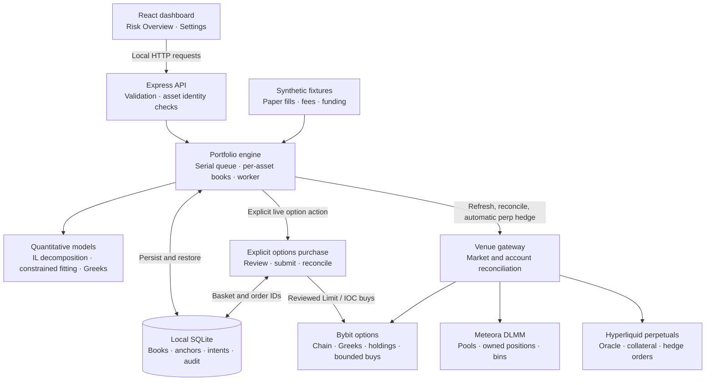

# Deltaform architecture

Deltaform is a local TypeScript research and execution workbench. A React dashboard presents risk; a persistent Node service owns portfolio state, quotes, reconciliation and automatic perpetual hedging. The browser can close while the service continues running. The worker still depends on its host being awake and connected.

## Design decisions

| Decision | Behavior and tradeoff | Implementation evidence |
| --- | --- | --- |
| Separate risk targets | Terminal IL uses a frozen benchmark; current gamma uses a horizon/IV model; the perpetual worker uses actual inventory delta | [Mathematics](MATH_NOTE.md), [payoff model](../src/quant/math.ts), [hedge policy](../server/policy.ts) |
| Constrain option proposals | Candidates share an underlying and purchase expiry; depth, lots, fees, budget and post-rounding residuals determine feasibility | [Fitter](../src/quant/fit.ts), [fitting tests](../tests/quant.fit.test.ts) |
| Use confirmed exposure | Proposed options are excluded from actual holdings until fills; partial or uncertain legs require reconciliation | [Options service](../server/bybit-options.ts), [state tests](../tests/bybit-options-state.test.ts) |
| Persist execution intentions | Order IDs and intentions are saved before dispatch; unknown outcomes block replacement orders | [Engine](../server/engine.ts), [store](../server/store.ts), [recovery](order-recovery.md) |
| Share account limits | Independent asset books reserve venue margin; shared cash and equity are counted once | [Multi-asset tests](../tests/multi-asset-engine.test.ts), [capital tracking](../server/capital-tracking.ts) |
| Isolate paper execution | The demo uses a temporary database, disconnected accounts and fixture feeds, with live mode blocked | [UI harness](../scripts/ui-qa.ts), [demo](DEMO.md), [validation](VALIDATION.md) |

## System map

The diagram shows implemented responsibilities. It does not imply an atomic trade across venues or verified production execution. Meteora is read for positions and pool state; the application does not automatically recenter liquidity. Options purchases and rolls remain explicit. Automatic execution adjusts the perpetual hedge only.

## Module guide

| Responsibility | Implementation | What it does |
| --- | --- | --- |
| Dashboard | [`src/client/App.tsx`](../src/client/App.tsx), [`MultiAssetOverview.tsx`](../src/client/MultiAssetOverview.tsx), [`TradingRisk.tsx`](../src/client/TradingRisk.tsx) | Positions, account capital, Greeks, quote review, payoff/model scenarios and hedge controls. |
| Client risk and requests | [`portfolio-risk.ts`](../src/client/portfolio-risk.ts), [`cash-greeks.ts`](../src/client/cash-greeks.ts), [`api.ts`](../src/client/api.ts) | Keep raw and cash-normalized sensitivities distinct; bind asset mutations to the underlying shown in the browser. |
| Local API | [`server/index.ts`](../server/index.ts) | Validate requests and route them through the engine queue; assemble services and start the worker. |
| Portfolio engine | [`server/engine.ts`](../server/engine.ts), [`multi-asset.ts`](../server/multi-asset.ts) | Own independent books, select/reconcile positions, compute execution delta, schedule refreshes and hedge cycles. |
| Hedge policy | [`server/policy.ts`](../server/policy.ts) | Apply price/delta triggers, deadbands, cooldown, exposure limits, margin, freshness and basis checks. |
| Mathematics | [`src/quant/math.ts`](../src/quant/math.ts), [`risk-model.ts`](../src/quant/risk-model.ts) | Bin inventory, fee-free terminal IL decomposition, option payoffs and smooth LP/option model Greeks. |
| Executable fitting | [`src/quant/fit.ts`](../src/quant/fit.ts), [`gamma.ts`](../src/quant/gamma.ts) | Fit listed strikes under common expiry, depth, lot sizes, leg and budget limits; support terminal payoff and current gamma objectives. |
| Scenarios and demo data | [`src/quant/simulation.ts`](../src/quant/simulation.ts), [`fixtures.ts`](../src/quant/fixtures.ts) | Model surfaces and illustrative strategy paths; synthetic positions and markets for paper demonstration. |
| Venue integration | [`server/live.ts`](../server/live.ts), [`src/venues/`](../src/venues/) | Normalize public markets and authenticated accounts; reconcile and submit supported venue orders. |
| Reviewed options orders | [`server/bybit-options.ts`](../server/bybit-options.ts), [`src/shared/option-execution.ts`](../src/shared/option-execution.ts) | Bind a basket to its account, network, quote, portfolio and price caps; persist and reconcile each submitted leg. |
| Durable state and recovery | [`server/store.ts`](../server/store.ts), [`hedge-recovery.ts`](../server/hedge-recovery.ts), [`capital-tracking.ts`](../server/capital-tracking.ts) | SQLite persistence, audit history, unresolved-intent review and flow-adjusted capital baselines. |
| Identity and authorization | [`src/shared/assets.ts`](../src/shared/assets.ts), [`server/auth.ts`](../server/auth.ts), [`secrets.ts`](../server/secrets.ts) | Exact mint mappings, local wallet ownership challenges and encrypted Hyperliquid agent storage. |

## Three separate risk calculations

**Terminal IL protection** uses the preserved original bin benchmark. The theoretical call/put decomposition describes a fixed-allocation, fee-free terminal payoff. Listed options approximate that payoff under executable constraints. See [the derivation and assumptions](MATH.md).

**Current gamma targeting** uses current LP bins, the selected model horizon and IV, plus the Greeks of filled options. A bounded discrete search proposes incremental long option purchases near the requested gamma target. It is a sensitivity calculation at quote time; it does not continuously rebalance options or establish terminal IL protection.

**Perpetual delta hedging** uses actual selected LP base inventory, accrued base fees, filled option delta and actual perpetual size. It targets either zero net underlying delta or the original HODL benchmark delta. Perpetuals contribute delta and have zero gamma in this model.

Proposed options are separate from actual holdings. Pre-expiry scenario plots hold the current perpetual size fixed; they do not forecast future automatic hedge trades. Illustrative strategy simulations are assumption-driven demonstrations, not empirical backtests.

## Paper and live paths

A new database opens in paper mode with synthetic fixtures. Loading the eight-asset demo creates independent BTC, ETH, SOL, XAUT, HYPE, XRP, MNT and DOGE books with shared simulated cash and collateral. An explicitly confirmed paper option quote updates the local ledger. The same hedge policy generates paper perpetual fills, including modeled costs and funding, without sending venue orders.

Trading mode and market source are separate. Paper mode can use public venue quotes while retaining simulated execution. The fixture demo requires no wallet or API credentials. Paper fills are not evidence of live liquidity, queue priority or exchange acceptance.

Live order paths require live mode and `ENABLE_LIVE_EXECUTION=true`. The Bybit options service additionally verifies the connected API account and reviews actual LP allocation, holdings, cash, open orders and the quote. Hyperliquid automation additionally requires verified owners, an approved server agent and valid mapped positions. Freshness, basis, account boundaries and venue-local margin constrain execution. The live switch alone does not satisfy these conditions.

Bybit API credentials remain server-side. Wallet private keys remain in wallets; a separate Hyperliquid agent key is encrypted in local storage. The API binds to loopback and checks Host/Origin and JSON mutations. This is a single-user local service; those controls do not provide authentication for an internet deployment.

Exact mint identity governs live asset mapping. The configured registry includes direct SOL and proxy representations for BTC, ETH, XAUT and HYPE. XRP, MNT and DOGE have no configured verified Solana mapping. A mapped representation still needs suitable pools, fresh options and a matching native perpetual. The recorded venue probe found no native Hyperliquid XAUT perpetual. Eight synthetic books therefore do not establish eight complete live strategies; see the dated [venue support contract](MULTI_ASSET_VENUES.md).

## Worker and multi-asset execution

The backend checks its books on a two-second scheduling interval. Public live refreshes default to ten seconds after the previous refresh completes, with bounded backoff; this is polling. Dashboard state polling is separate from execution.

Each asset retains its own positions, benchmark, filled options, settings, quote, alpha anchor and pending intent. The worker serializes each book cycle with HTTP mutations and releases the queue between books. Shared account cash and equity are counted once. Other books reserve actual, desired and pending perpetual margin before a new hedge; raw deltas from different underlyings are not netted to skip execution.

Initial enable, a portfolio change, a large delta deviation, or a price move of `abs(S_now / S_anchor - 1) >= alpha / 100` can trigger reconciliation. The anchor advances after confirmed completion within the executable tolerance, including a completed deadband cycle. An unresolved or incomplete hedge retains its prior anchor. Pause prevents new automation and leaves existing positions open; closing the perpetual is a separate action.

## Persistence and order recovery

[`Store`](../server/store.ts) uses Node's SQLite implementation, WAL journaling, a JSON key/value table and a separate audit table. Paper and live portfolio states are saved separately. Per-asset state includes anchors and pending intents; capital baselines and manually recorded external flows are durable. The dashboard displays a bounded recent-event list while history export reads the complete stored audit history. A local worker lock prevents a second execution service from using the same database.

A Hyperliquid intent is saved **before** submission, with its underlying, client order ID, quantity, limit price and applied fills. Restarted live automation enters reconciliation. Unknown or resting outcomes block a replacement order; subsequent checks reconcile the original client ID and fills. Account position updates and incremental fill accounting avoid treating an acknowledgment as a completed hedge.

A Bybit basket persists its reviewed orders and `orderLinkId` values. Each leg transitions to submitting before the request is sent. Partial, rejected or unresolved results stop remaining legs. Reconciliation compares order status and actual holdings before clearing the pending blocker; it does not replay an unknown order using a new ID. Separate option legs and venue actions remain non-atomic.

The explicit local archival workflow for an unresolved Hyperliquid intent currently supports SOL and HYPE. It requires all automation paused, read-only venue evidence and a fresh confirmation. An eligible record is archived as `abandoned-unknown` with its evidence; this clears only the local blocker and does not prove the venue never accepted the request. See [recovery semantics](order-recovery.md).

## Evidence and limits

Focused tests cover [mathematics](../tests/quant.math.test.ts), [fitting](../tests/quant.fit.test.ts), [gamma targeting](../tests/gamma-fit.test.ts), [hedge policy](../tests/policy.test.ts), [the engine](../tests/engine.test.ts), [multi-asset execution](../tests/multi-asset-engine.test.ts), [Bybit state](../tests/bybit-options-state.test.ts), [persistence](../tests/store.test.ts) and [recovery](../tests/hedge-recovery.test.ts). Mocked order tests and paper walkthroughs validate implementation behavior; they do not certify live fills or strategy profitability.

The repository's dated [venue records](MULTI_ASSET_VENUES.md) distinguish public read-only discovery from authenticated multi-asset execution, which those records do not verify. Legacy Derive code and tests are retained; `/api/derive` is retired and cannot act as another live options route.

Account capital is marked within a defined portfolio boundary. Per-asset P&L allocation and a complete durable flow-adjusted equity time series remain unavailable. Stablecoin parity, wrapper and cross-venue basis, model error, sparse strikes, option premiums, funding, fees, slippage and residual exposure remain relevant to the research goal. Implemented hedging machinery does not establish that LP fee income covers those costs.
