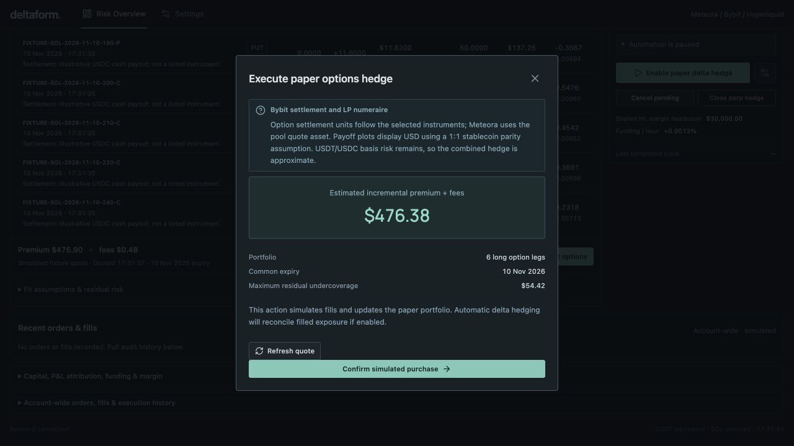

# Five-minute synthetic paper walkthrough

This walkthrough demonstrates the implemented hedge workflow: a constrained option proposal, explicit simulated fills, and a separate perpetual delta cycle. Start with the [README](../README.md) for the research question or the [short math note](MATH_NOTE.md) for the hedge identities.

Run `npm ci`, `npm run build`, and `npm run demo:showcase`, then open http://127.0.0.1:8788/.

The showcase launcher is the existing isolated UI harness. It does not load `.env`, construct the live Gateway, or connect accounts. It creates a new temporary SQLite database, runs the real paper Engine, rejects live mode, and permits only synthetic fixture markets. Every launch starts fresh.

All displayed prices, balances, option instruments, fees, positions, and fills are synthetic. They illustrate the interface and execution state, not trading performance. A hypothetical paper purchase is not an exchange trade.

## 1. Inspect the portfolio

Risk Overview opens with eight synthetic asset books. Select SOL and inspect its 69-bin position, current inventory, and model/venue Greeks. Cash delta and gamma P&L are display conventions; Raw units exposes the underlying measures.

The eight demo assets are a fixture catalog, not a promise of eight live-supported strategies. The live implementation gates token mappings and venue routes independently.

## 2. Quote terminal IL protection

The showcase starts with a common expiry, 70% coverage, a $1,500 synthetic budget, and at most six legs. Select **Quote hedge** and inspect **Proposed options**. Proposed legs are incremental purchases; they do not enter actual portfolio risk before simulated fills.

Review strike, quantity, depth, minimum size, premium, fee estimate, residual undercoverage, and tail error. The particular quote changes with the fixture time to expiry.

## 3. Review and simulate a purchase

Select **Cover IL with Bybit options**, then **Confirm simulated purchase**. The paper account now contains filled options, and the recent orders table records the simulated fill.

This screenshot was captured from the isolated harness during the 11 October 2026 validation and is reused in this presentation. The displayed dollar amounts and expiry are synthetic and illustrative.

## 4. Complete a paper delta hedge

Select **Enable paper delta hedge**. The persistent worker uses the actual paper LP inventory plus filled-option delta. The default order cap can require multiple cycles; the initial anchor is established only after the residual is within tolerance. Inspect the completed cycle, actual perpetual size, residual, and audit events.

In Settings, increase the paper reference price by 1.5%, beyond the default 1% alpha threshold. Return to Risk Overview to inspect the new paper fill and updated anchor. Select **Pause All** when finished. Pausing leaves the synthetic positions open.

## 5. Compare objectives and views

Open **Payoff** to compare terminal LP, HODL, and option payoffs. Inspect the pre-expiry model separately: it includes the fixed current perpetual position and excludes projected future hedge paths.

For current gamma targeting, pause the worker, open Settings, change **Hedge objective** to **Current gamma neutrality**, and re-quote. Inspect the residual tolerance, budget, and feasibility status. A gamma target is a current local sensitivity, not equivalent to terminal IL coverage.

## Reset and reproducibility

Settings → **Load eight-asset demo** resets only the isolated paper books. Stopping and restarting the showcase creates a fresh temporary database. No production database, existing account, or live worker is used.

For deterministic adverse UI presets, see [UI_QA.md](UI_QA.md). The screenshot record is in [VALIDATION.md](VALIDATION.md).
